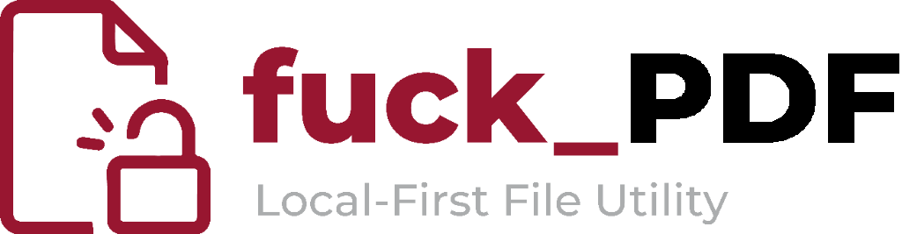

<p align="center">
  
</p>

<h3 align="center">Local-First PDF, Archive &amp; Media Workbench</h3>

<p align="center">
  Utilitas web <strong>local-first</strong> berbasis WebAssembly &amp; Web Workers untuk membuka kunci PDF/arsip, mengedit objek PDF ala Adobe Acrobat, mengonversi dokumen &amp; media, serta mengelola halaman PDF langsung di browser.
</p>

---

## Fitur Utama

### 1. All PDF Tools (Menu Utama Terkategori)
- **Organize PDF**: Merge PDF (multi-file), Split PDF, Remove Pages, Extract Pages, Organize Pages (drag/keyboard reorder), dan Scan / Photos to PDF.
- **Optimize PDF**: Compress PDF (preset DPI), Repair PDF (lokal via `qpdf --linearize` + Cloud Fallback), dan OCR PDF (opt-in Cloud).
- **Convert to PDF**: JPG/PNG to PDF, WORD (`.docx`) to PDF, EXCEL (`.xlsx`/`.csv`) to PDF, HTML/Markdown to PDF (lokal), serta POWERPOINT to PDF (opt-in Cloud).
- **Convert from PDF**: PDF to JPG/PNG (bundel ZIP otomatis untuk multi-halaman), PDF to Markdown (`.md`), PDF to WORD (`.doc`), PDF to EXCEL (`.xlsx`), dan PDF to PDF/A (opt-in Cloud).
- **Edit PDF**:
  - **Edit Objek (Teks &amp; Gambar)**: Klik teks PDF untuk mengedit di tempat dengan pencocokan warna teks &amp; latar otomatis; klik gambar tertanam untuk memindahkan, mengubah ukuran, atau menghapus.
  - **Anotasi &amp; Fill &amp; Sign**: Tambah teks, edit teks inline (*double-click*), gambar bebas (*freehand*), kotak, *highlight*, garis bawah, *link*, tanda tangan kanvas PNG, stempel cepat (`✓` / `✗`), pengisian form PDF (AcroForm), dan redaksi permanen (*rasterized*).
  - **Tata Letak &amp; Halaman**: Undo/Redo (`Ctrl+Z` / `Ctrl+Y`), Zoom kanvas, Header &amp; Footer, Watermark teks, Nomor Halaman, dan **Crop PDF** (seret langsung garis crop di kanvas atau samakan ukuran halaman secara satuan/rentang/bulk).
- **PDF Security**:
  - **Unlock PDF &amp; Arsip** (`.pdf`, `.zip`, `.rar`/RAR5, `.7z`): Deteksi enkripsi otomatis, 3-tahap auto-unlock (*owner-strip*, *Password Vault* + pola nama file, *Smart Recovery* PIN 4-digit/tanggal lahir), batch PDF + ZIP, dan Cloud Fallback opt-in.
  - **Protect PDF**: Enkripsi PDF AES-256 100% lokal via `qpdf.wasm`.
  - **Compare PDF**: Perbandingan visual berdampingan dan diff teks baris-per-baris antara dua PDF.

### 2. Privasi, Keamanan &amp; PWA
- **Local-First &amp; Offline Ready**: Pemrosesan utama berjalan di RAM browser menggunakan WebAssembly (`qpdf`, `7z-wasm`, `ffmpeg.wasm`, `unrar`) dan Web Workers, dilengkapi Service Worker PWA.
- **Audit Telemetri &amp; Cache**: Badge telemetri real-time di TopBar serta modal **Security &amp; Cache**, **License (MIT)**, **Privacy**, dan halaman **404**.
- **Multi-Bahasa**: Bahasa Indonesia (`id`), English (`en`), 中文 (`zh`), dan 日本語 (`ja`).

---

## Tech Stack

- **Frontend**: React 19, TypeScript, Vite, Tailwind CSS v4, Lucide Icons
- **PDF &amp; Document Engines**: `pdfjs-dist`, `pdf-lib`, `@neslinesli93/qpdf-wasm`, `jspdf`, `mammoth`, `xlsx`, `marked`, `turndown`
- **Archive &amp; Media Engines**: `@zip.js/zip.js`, `node-unrar-js`, `7z-wasm`, `fflate`, `@ffmpeg/ffmpeg`, `pica`, `libheif-js`
- **Testing &amp; PWA**: Vitest, Testing Library, `vite-plugin-pwa`

---

## Menjalankan Secara Lokal

```bash
# 1. Install dependencies
npm install

# 2. (Opsional) Salin template env untuk fitur Cloud Fallback
cp .env.example .env.local

# 3. Jalankan dev server
npm run dev
```

### Script Tersedia

| Perintah | Keterangan |
| :--- | :--- |
| `npm run dev` | Menjalankan Vite dev server (`http://localhost:5173`) |
| `npm test` | Menjalankan unit test dengan Vitest (`vitest run`) |
| `npm run build` | Type-check TypeScript (`tsc -b`) dan build produksi (`dist/`) |
| `npm run preview` | Pratinjau hasil build produksi secara lokal |

---

## Deploy ke Vercel

Repositori ini sudah dilengkapi [vercel.json](vercel.json) (header keamanan `CSP`, `COOP/COEP`, `X-Frame-Options`, `nosniff`, `HSTS`, dan SPA rewrite) serta serverless proxy [api/cloud-auth.ts](api/cloud-auth.ts) agar API key tidak pernah masuk ke repositori maupun bundle frontend.

1. Import repositori ke **Vercel**.
2. Pada **Project Settings → Environment Variables**, tambahkan:
   - `CLOUD_PDF_PUBLIC_KEY` = public key untuk Cloud Fallback
3. Deploy (atau **Redeploy** jika env baru ditambahkan).

---

## Lisensi &amp; Dukungan

- Dirilis di bawah **MIT License**.
- Jika aplikasi ini bermanfaat, Anda dapat mendukung pengembangannya melalui [SociaBuzz](https://sociabuzz.com/ikirieyu).
